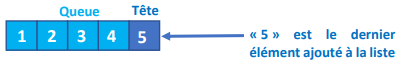
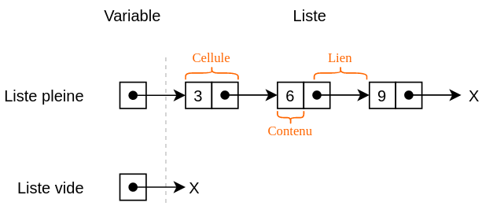
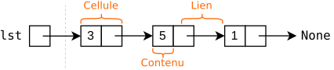
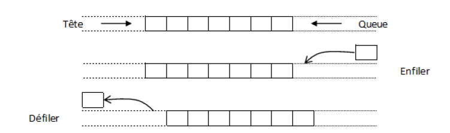
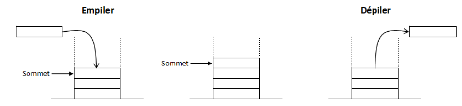
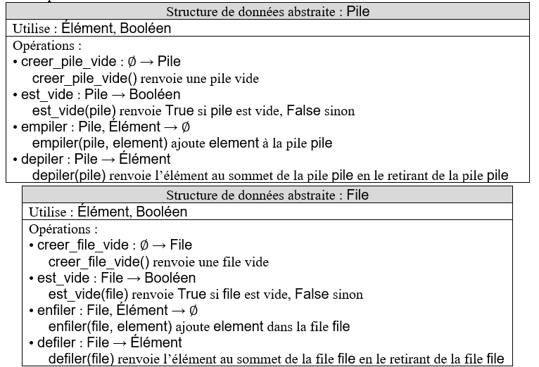
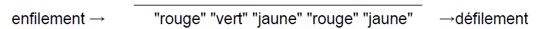
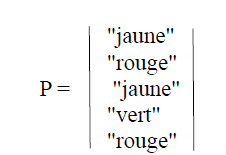

# Thème 3 : Structures linéaires { #lineaires }

<a id="haut"></a>

!!! abstract "Objectif"

    Dans ce chapitre, nous allons étudier différentes structures de données linéaires.

    Nous chercherons notamment à comprendre :

    - ce qu'est une structure de données abstraite ;
    - comment fonctionne une liste ;
    - comment implémenter une liste chaînée ;
    - comment fonctionne une file et le principe FIFO ;
    - comment fonctionne une pile et le principe LIFO ;
    - comment implémenter ces structures à l'aide de classes Python ;
    - comment utiliser une pile pour implémenter une file et inversement.

    À la fin de ce chapitre, vous devrez être capables de choisir une structure de données adaptée à un problème, de simuler les opérations qui lui sont appliquées et d'implémenter les opérations fondamentales d'une liste chaînée, d'une pile et d'une file en Python.

---

## 1. Les structures linéaires { #structures-lineaires }

!!! note "Structure linéaire"


    Certains algorithmes manipulent des données stockées dans des structures diverses.

    Nous allons voir trois types de structures dites **linéaires** : les listes, les files et les piles.

    Ces structures sont appelées linéaires car il existe un moyen, à partir de n'importe quel élément qui n'est pas le dernier, d'accéder à un « successeur ».

    Dans une structure linéaire, les éléments sont organisés selon un ordre. En revanche, les opérations autorisées pour accéder aux éléments, en ajouter ou en retirer dépendent de la structure considérée. Une liste, une file et une pile ne permettent donc pas nécessairement les mêmes manipulations.

{ width="300" }

!!! note "Structure de données abstraite"

    Une **structure de données abstraite** (ou SDA) est une représentation d'un ensemble de données ainsi que les opérations qui s'y appliquent.

    La structure est dite abstraite car on n'a pas besoin de savoir comment les données sont représentées, ou comment les opérations sont implémentées.

    Exemple :

    ```python
    class Point:

        def __init__(self):
            """
            initialisation non précisée, on ne connait pas les détails de stockage
            """
            ...

        def translate(self, x, y):
            """
            on ne connait pas l'implémentation de l'opération, mais juste sa spécification
            rôle : déplace le point de x en abscisse et y en ordonnée
            @param x : (int)
            @param y : (int)
            @return : None
            """
            ...
    ```

    La structure `Point` représentée plus haut est une SDA, car on ne sait pas comment sont représentées les données (tuple, tableau, dictionnaire, ...) et on ne sait pas comment les opérations sont implémentées.

!!! tip "SDA et implémentation"

    Il faut distinguer deux notions :

    - **La structure de données abstraite (SDA)** décrit les données manipulées et les opérations disponibles, sans imposer la manière dont elles sont stockées.
    - **L'implémentation** décrit la manière concrète dont les données sont représentées en mémoire et dont les opérations sont réalisées.

    Une même SDA peut donc posséder plusieurs implémentations. Par exemple, une pile peut être implémentée à l'aide d'un tableau Python ou d'une liste chaînée, tout en conservant les mêmes opérations et le même comportement.!!! tip "SDA et implémentation"

---

## 2. Les listes { #listes }

!!! note "Liste"

    Une liste est une structure abstraite de données permettant de regrouper des données sous une forme séquentielle.

    Elle est constituée d'éléments d'un même type, chacun possédant un rang.

    Une liste est évolutive : on peut ajouter ou supprimer n'importe lequel de ses éléments.

    Une liste `L` est composée de deux parties :

    - sa **tête** qui correspond au dernier élément ajouté à la liste ;
    - sa **queue** qui correspond au reste de la liste.

    { width="350" }
 

    Le langage de programmation Lisp, conçu par John McCarthy en 1958, est l'un des premiers langages à avoir fait des listes une structure de données fondamentale. Son nom vient de LISt Processing (« traitement de listes »).

    Voici les opérations pouvant être effectuées sur une liste chaînée :

    | Actions | Instruction |
    |---|---|
    | Créer une liste chaînée `L` vide | `L = vide()` |
    | Tester si la liste chaînée `L` est vide | `estVide(L)` |
    | Ajouter un élément `x` en tête de la liste chaînée `L` | `ajouteEnTete(x,L)` |
    | Supprimer le premier élément de `L` et renvoyer sa valeur | `supprEnTete(L)` |
    | Compter le nombre d'éléments de `L` | `compte(L)` |
    | Construire une nouvelle liste chaînée à partir d'un élément `x` et d'une liste `L` | `L1 = cons(x,L)` |


!!! question "Exercice 1 — Ba-liste-ique"


    **1.** Voici une série d'instructions. Les instructions ci-dessous s'enchaînent. Expliquez ce qui se passe à chacune des étapes :

    ```python 
    L = vide() 
    estVide(L) 
    ajouteEnTete(3,L) 
    estVide(L) 
    ajouteEnTete(5,L) 
    ajouteEnTete(8,L) 
    t = supprEnTete(L) 
    L1 = vide() 
    L2 = cons(8, cons(5, cons(3, L1))) 
    ```

    **2.** Voici une série d'instructions. Les instructions ci-dessous s'enchaînent. Expliquez ce qui se passe à chacune des étapes : 

    ```python 
    L = vide() 
    ajoutEnTete(10,L) 
    ajoutEnTete(9,L) 
    ajoutEnTete(7,L) 
    L1 = vide() 
    L2 = cons(5, cons(4, cons(3, cons(2, cons(1, cons(0,L1)))))) 
    ```

---

## 3. Les listes chaînées { #listes-chainees }


!!! note "Liste chaînée"

    { width="200" }

    Lorsque l'implémentation de la liste fait apparaître une chaîne de valeurs, chacune pointant vers la suivante, on dit que la liste est une **liste chaînée**. Chaque élément est donc stocké dans un bloc mémoire avec une deuxième information : l'adresse de l'élément suivant. On parle de **maillon**, **cellule** ou encore **node** pour désigner ces blocs.

    { width="350" }

    **Interface :** on dispose, ou souhaite disposer, sur une liste chaînée des méthodes/primitives suivantes : 
    
    - construire une liste vide, souvent nommée `nil` ; 
    - déterminer si la liste est vide (`est_vide`, `is_empty`) ; 
    - insérer un élément en tête de liste (`insert`) ; 
    - récupérer l'élément en tête de liste (`tete`, `head`) ; 
    - récupérer la liste privée de son premier élément, appelée la queue (`queue`, `tail`).

    Ces opérations doivent être réalisées en temps constant.


!!! activity "Activité 1 — Implémentation"

    **1.** Écrire une classe `Cellule`, possédant deux attributs : `contenu` (la valeur de la cellule) et `suivante` (une instance de la classe `Cellule`).

    On pourra alors créer une liste chaînée de la façon suivante : 

    ```python 
    lst = Cellule(3, Cellule(5, Cellule(1, None))) 
    ``` 
    La liste construite sera de la forme suivante : 

    { width="350" }

    **2.** Écrire les lignes de code permettant d'afficher la valeur de toutes les cellules.

---

!!! question "Exercice 2 — Ecris liste oire"

    On dispose de l'interface offrant les fonctionnalités suivantes :

    - `ListeC()` : crée une liste vide ;
    - `est_vide()` : indique si la liste est vide ;
    - `ajoute_tete()` : insère un élément en tête de liste ;
    - `renvoie_tete()` : renvoie la valeur de l'élément en tête de liste et le supprime de la liste.

    **1.** On considère l'enchaînement d'opérations ci-dessous. Écrire à chaque étape l'état de la liste `lst` et la valeur éventuellement renvoyée.

    ```python 
    lst = ListeC() 
    lst.ajoute_tete(3) 
    lst.ajoute_tete(5) 
    lst.ajoute_tete(1) 
    lst.renvoie_tete() 
    lst.est_vide() 
    lst.ajoute_tete(2) 
    lst.renvoie_tete() 
    lst.renvoie_tete() 
    lst.renvoie_tete() 
    lst.est_vide() 
    ```

---

!!! activity "Activité 2 — Classe à Dallas"

    **1.** Ajouter une méthode `__str__` à votre classe `Cellule`. Elle affichera le contenu de la cellule et celui des suivantes si elles existent.

    Elle renverra donc :

    ```text
    3 -> 5 -> 1
    ```

    pour la liste `lst` créée précédemment.

    **2.** Compléter la classe `ListeC` suivante :

    ```python
    class ListeC:
        def __init__(self):
            self.tete = None  # Liste vide

        def ajoute_tete(self, valeur):
            '''
            Créer une nouvelle cellule contenant la valeur et l'ajouter en tête.
            '''
            ...

        def est_vide(self):
            '''
            Indiquer si la liste est vide ou non.
            @return : (bool) True si vide, False sinon
            '''
            ...

        def renvoie_tete(self):
            '''
            Renvoyer le contenu de la tête de la liste et la retirer
            '''
            ...

        def __str__(self):  # affichage de la liste
            c = self
            l = []
            while not c.est_vide():
                l.append(str(c.renvoie_tete()))
            l.reverse()
            for v in l:
                self.ajoute_tete(v)
            l.reverse()
            return ' -> '.join(l)
    ```

    **3.** Écrire la suite d'instructions permettant de vérifier votre réponse à l'exercice 2.


---

## 4. Les files { #files }

!!! note "File"

    Une **file** est une structure linéaire basée sur le principe du **First In First Out** (*premier arrivé, premier sorti* en français), ou plus simplement **FIFO**.

    On ne peut donc accéder qu'au premier élément, appelé **tête**, et n'ajouter qu'en fin de file, appelée **queue**.

    

    La SDA de la file serait donc :

    - `init` pour créer une file vide ;
    - `enfiler` pour ajouter un élément à la fin de la file ;
    - `défiler` pour retirer et récupérer le premier élément ;
    - `est_vide` pour savoir si la file est vide.

    D'autres opérations peuvent être données au cas par cas.

    **Exemple :**

    ```python
    F = File()
    F.enfiler(1)
    F.enfiler(2)
    F.enfiler(3)
    nb = F.defiler()
    F.enfiler(4)
    ```

    À la fin de la manipulation, la file `F` contient les éléments `2`, `3` et `4`, et `nb` vaut alors `1`.

---

!!! question "Exercice 3 — File dans ta chambre"

    Dans les différentes questions, vous considérez pouvoir utiliser les opérations de la SDA donnée ci-dessous.

    ```python
    class File:
        def __init__(self):
            ...

        def enfiler(self, x):
            ...

        def defiler(self):
            ...

        def est_vide(self):
            ...
    ```

    **1.** Écrire une suite d'instructions permettant de créer une instance de la classe `File` affectée à la variable `ma_file` contenant les éléments `1`, `2` et `3` insérés dans cet ordre.

    **2.** Donner l'affichage obtenu après les appels suivants.

    ```python
    # On considère ma_deuxieme_file bien initialisée comme une file vide
    ma_deuxieme_file.enfiler(5)
    ma_deuxieme_file.enfiler(4)
    ma_deuxieme_file.enfiler(3)
    ma_deuxieme_file.defiler()
    ma_deuxieme_file.defiler()
    ma_deuxieme_file.enfiler(4)
    ma_deuxieme_file.enfiler(ma_deuxieme_file.defiler())
    ``` 

    **3.** Donner une implémentation de l'opération `taille` renvoyant le nombre d'éléments d'une file en utilisant seulement les éléments Python de base et les opérations de la SDA données précédemment.

    **4.** Donner une implémentation de l'opération `inverser` permettant d'inverser les éléments de la file.

    La file d'ordre `1`, `2` et `3` deviendra donc la file d'ordre `3`, `2` et `1` après exécution de l'opération `inverser`.


---

!!! activity "Activité 3 — File un mauvais coton"

    **1.** Implémenter une SDA possible de cette structure de données en utilisant les tableaux.

    Plus précisément, compléter les opérations `init`, `enfiler`, `defiler` et `est_vide` en stockant les données dans des tableaux.

    **2.** Écrire un bref jeu de test permettant de valider votre implémentation.


---

## 5. Les piles { #piles }

!!! note "Pile"

    Une **pile** est une structure linéaire basée sur le principe du **Last In First Out** (*dernier arrivé, premier sorti* en français), ou plus simplement **LIFO**.

    On ne peut donc accéder qu'au dernier élément ajouté, appelé **sommet**, et n'ajouter qu'au-dessus du sommet.

    

    La SDA de la pile serait donc :

    - `init` pour créer une pile vide ;
    - `empiler` pour ajouter un élément au-dessus de la pile ;
    - `dépiler` pour retirer et récupérer le sommet ;
    - `est_vide` pour savoir si la pile est vide.

    D'autres opérations peuvent être données au cas par cas.

    **Exemple :**

    ```python
    P = Pile()
    P.empiler(1)
    P.empiler(2)
    P.empiler(3)
    nb = P.depiler()
    P.empiler(4)
    ```

    À la fin de la manipulation, la pile `P` contient les éléments `4`, `2` et `1`, avec `4` comme sommet, et `nb` vaut `3`.


!!! question "Exercice 4 — Pile à l'heure"


    Dans les différentes questions, vous considérez pouvoir utiliser les opérations de la SDA donnée ci-dessous.

    ```python
    class Pile:
        def __init__(self):
            ...

        def empiler(self, x):
            ...

        def depiler(self):
            ...

        def est_vide(self):
            ...
    ```

    **1.** Écrire une suite d'instructions permettant de créer une instance de la classe `Pile` affectée à la variable `ma_pile` contenant les éléments `3`, `2` et `1` insérés dans cet ordre.

    **2.** Donner l'affichage obtenu après les appels suivants.

    ```python
    # On considère ma_deuxieme_pile bien initialisée comme une pile vide
    ma_deuxieme_pile.empiler(20)
    ma_deuxieme_pile.empiler(7)
    ma_deuxieme_pile.empiler(68)
    ma_deuxieme_pile.depiler()
    ma_deuxieme_pile.depiler()
    ma_deuxieme_pile.empiler(45)
    ma_deuxieme_pile.empiler(ma_deuxieme_pile.depiler())
    ```

    **3.** Donner une implémentation de l'opération `taille` renvoyant le nombre d'éléments d'une pile en utilisant seulement les éléments Python de base et les opérations de la SDA données précédemment.

    **4.** Donner une implémentation de l'opération `inverser` permettant d'inverser les éléments de la pile.

    La pile d'ordre `1`, `2` et `3` (avec `1` comme sommet) deviendra donc la pile d'ordre `3`, `2` et `1` (avec `3` comme sommet) après exécution de l'opération `inverser`.


---

!!! activity "Activité 4 — Pile Poil"

    **1.** Implémenter une SDA possible de cette structure de données en utilisant les tableaux.

    Plus précisément, compléter les opérations `init`, `empiler`, `depiler` et `est_vide` en stockant les données dans des tableaux.

    **2.** Écrire un bref jeu de test permettant de valider votre implémentation.


---

!!! activity "Activité 5 — Dupile et Dufile"

    Vous possédez une SDA de la file semblable à celle présentée dans l'exercice 3.

    **1.** Grâce à la SDA de la file, implémenter une classe `Pile` en utilisant les files.

    Vous possédez une SDA de la pile semblable à celle présentée dans l'exercice 4.

    **2.** Grâce à la SDA de la pile, implémenter une classe `File` en utilisant les piles.


---

!!! question "Exercice 5 — Midi Pile"

    On crée une classe `Pile` qui modélise la structure d'une pile d'entiers.

    Le constructeur de la classe initialise une pile vide.

    La définition de cette classe sans l'implémentation de ses méthodes est donnée ci-dessous.

    ```python
    class Pile:
        def __init__(self):
            """Initialise la pile comme une pile vide."""

        def est_vide(self):
            """Renvoie True si la liste est vide, False sinon."""

        def empiler(self, e):
            """Ajoute l'élément e sur le sommet de la pile, ne renvoie rien."""

        def depiler(self):
            """Retire l'élément au sommet de la pile et le renvoie."""

        def nb_elements(self):
            """Renvoie le nombre d'éléments de la pile."""

        def afficher():
            """Affiche de gauche à droite les éléments de la pile, du fond
            de la pile vers son sommet. Le sommet est alors l'élément
            affiché le plus à droite. Les éléments sont séparés par une
            virgule. Si la pile est vide la méthode affiche "pile vide"."""
    ```


    !!! warning "Attention !"

        **Seules les méthodes de la classe ci-dessus doivent être utilisées pour manipuler les objets `Pile`.**

    **1.**

    **a.** Écrire une suite d'instructions permettant de créer une instance de la classe `Pile` affectée à une variable `pile1` contenant les éléments `7`, `5` et `2` insérés dans cet ordre.

    Ainsi, à l'issue de ces instructions, l'instruction `pile1.afficher()` produit l'affichage :

    ```text
    7, 5, 2
    ```

    **b.** Donner l'affichage produit après l'exécution des instructions suivantes.

    ```python
    element1 = pile1.depiler()
    pile1.empiler(5)
    pile1.empiler(element1)
    pile1.afficher()
    ```

    **2.** On donne la fonction `mystere` suivante.

    ```python
    def mystere(pile, element) :
        pile2 = Pile()
        nb_elements = pile.nb_elements()
        for i in range(nb_elements) :
            elem = pile.depiler()
            pile2.empiler(elem)
            if elem == element :
                return pile2
        return pile2
    ```

    **a.** Dans chacun des quatre cas suivants, quel est l'affichage obtenu dans la console ?


    a.
    ```python
    >>>pile.afficher()
    7, 5, 2, 3
    >>>mystere(pile, 2).afficher()
    ```
    b.
    ```python
    >>>pile.afficher()
    7, 5, 2, 3
    >>>mystere(pile, 9).afficher()
    ```
    c.
    ```python
    >>>pile.afficher()
    7, 5, 2, 3
    >>>mystere(pile, 3).afficher()
    ```
    d.
    ```python
    >>>pile.est_vide()
    True
    >>>mystere(pile, 3).afficher()
    ```

    **b.** Expliquer ce que permet d'obtenir la fonction `mystere`.


    **3.** Écrire une fonction `etendre(pile1, pile2)` qui prend en arguments deux objets `Pile` appelés `pile1` et `pile2` et qui modifie `pile1` en lui ajoutant les éléments de `pile2` rangés dans l'ordre inverse.

    Cette fonction ne renvoie rien.

    On donne ci-dessous les résultats attendus pour certaines instructions.

    ```python
    >>>pile1.afficher()
    7, 5, 2, 3
    >>>pile2.afficher()
    1, 3, 4
    >>>etendre(pile1, pile2)
    >>>pile1.afficher()
    7, 5, 2, 3, 4, 3, 1
    >>>pile2.est_vide()
    True
    ```


    **4.** Écrire une fonction `supprime_toutes_occurences(pile, element)` qui prend en arguments un objet `Pile` appelé `pile` et un élément `element` et supprime tous les éléments `element` de `pile`.

    On donne ci-dessous les résultats attendus pour certaines instructions.

    ```python
    >>>pile.afficher()
    7, 5, 2, 3, 5
    >>>supprime_toutes_occurences(pile, 5)
    >>>pile.afficher()
    7, 2, 3
    ```


---

!!! question "Exercice 6 — File du rasoir"

    Un supermarché met en place un système de passage automatique en caisse.

    Un client scanne les articles à l'aide d'un scanner de code-barres au fur et à mesure qu'il les ajoute dans son panier.

    Les articles s'enregistrent alors dans une structure de données.

    La structure de données utilisée est une file définie par la classe `Panier`, avec les primitives habituelles sur la structure de file.

    Pour faciliter la lecture, le code de la classe `Panier` n'est pas écrit.

    ```python
    class Panier:
        def __init__(self):
            """Initialise la file comme une file vide."""

        def est_vide(self):
            """Renvoie True si la file est vide, False sinon."""

        def enfiler(self, e):
            """Ajoute l'élément e en dernière position de la file, ne renvoie rien."""

        def defiler(self):
            """Retire le premier élément de la file et le renvoie."""
    ```

    Le panier d'un client sera représenté par une file contenant les articles scannés.

    Les articles sont représentés par des tuples `(code_barre, designation, prix, horaire_scan)` où :

    - `code_barre` est un nombre entier identifiant l'article ;
    - `designation` est une chaîne de caractères qui pourra être affichée sur le ticket de caisse ;
    - `prix` est un nombre décimal donnant le prix d'une unité de cet article ;
    - `horaire_scan` est un nombre entier de secondes permettant de connaître l'heure où l'article a été scanné.

    **1.** On souhaite ajouter un article dont le tuple est le suivant :

    ```python
    (31002, "café noir", 1.50, 50525)
    ```

    Écrire le code utilisant une des quatre méthodes ci-dessus permettant d'ajouter l'article à l'objet de classe `Panier` appelé `panier1`.

    **2.** On souhaite définir une méthode `remplir(panier_temp)` dans la classe `Panier` permettant de remplir la file avec tout le contenu d'un autre `panier_temp` qui est un objet de type `Panier`.

    Recopier et compléter le code de la méthode `remplir` en remplaçant chaque `...` par la primitive de file qui convient.

    ```python
    def remplir(self, panier_temp):
        while not panier_temp. ......... :
            article = panier_temp. ...........
            self. ...........(article)
    ```

    **3.** Pour que le client puisse connaître à tout moment le montant de son panier, on souhaite ajouter une méthode `prix_total()` à la classe `Panier` qui renvoie la somme des prix de tous les articles présents dans le panier.

    Écrire le code de la méthode `prix_total`.

    **Attention :** après l'appel de cette méthode, le panier devra toujours contenir ses articles.

    **4.** Le magasin souhaite connaître pour chaque client la durée des achats.

    Cette durée sera obtenue en faisant la différence entre le champ `horaire_scan` du dernier article scanné et le champ `horaire_scan` du premier article scanné dans le panier du client.

    Un panier vide renverra une durée égale à zéro.

    On pourra accepter que le panier soit vide après l'appel de cette méthode.

    Écrire une méthode `duree_courses` de la classe `Panier` qui renvoie cette durée.


---

!!! question "Exercice 7 — File du rasoir"


    Les interfaces des structures de données abstraites `Pile` et `File` sont proposées ci-dessous.

    On utilisera uniquement les fonctions ci-dessous :

    

    **1.**

    **a.** On considère la file `F` suivante :

    

    Quel sera le contenu de la pile `P` et de la file `F` après l'exécution du programme Python suivant ?

    ```python
    P = creer_pile_vide()
    while not (estvide(F)):
        empiler(P, defiler(F))
    ```

    **b.** Créer une fonction `taille_file` qui prend en paramètre une file `F` et qui renvoie le nombre d'éléments qu'elle contient.

    Après appel de cette fonction, la file `F` doit avoir retrouvé son état d'origine.

    **2.** Écrire une fonction `former_pile` qui prend en paramètre une file `F` et qui renvoie une pile `P` contenant les mêmes éléments que la file.

    Le premier élément sorti de la file devra se trouver au sommet de la pile ; le deuxième élément sorti de la file devra se trouver juste en-dessous du sommet, etc.

    **Exemple :** si

    ```text
    F = "rouge" "vert" "jaune" "rouge" "jaune"
    ```

    alors l'appel `former_pile(F)` va renvoyer la pile `P` ci-dessous :

    

    **3.** Écrire une fonction `nb_elements` qui prend en paramètres une file `F` et un élément `elt` et qui renvoie le nombre de fois où `elt` est présent dans la file `F`.

    Après appel de cette fonction, la file `F` doit avoir retrouvé son état d'origine.

    **4.** Écrire une fonction `verifier_contenu` qui prend en paramètres une file `F` et trois entiers : `nb_rouge`, `nb_vert`, `nb_jaune`.

    Cette fonction renvoie le booléen `True` si `"rouge"` apparaît au plus `nb_rouge` fois dans la file `F`, `"vert"` apparaît au plus `nb_vert` fois dans la file `F` et `"jaune"` apparaît au plus `nb_jaune` fois dans la file `F`.

    Elle renvoie `False` sinon.

    On pourra utiliser les fonctions précédentes.

