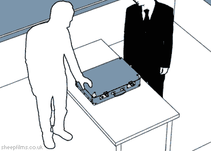
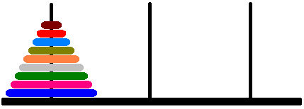
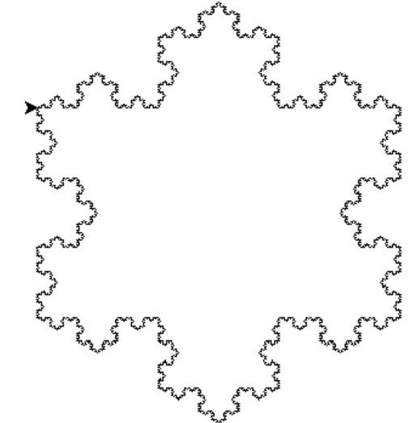
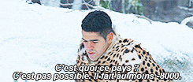

# Thème 4 : Récursivité { #recursivite }

<a id="haut"></a>


<iframe 
    src="../04_diapo_intro_recursivite.pdf"
    width="100%"
    height="400px">
</iframe>

!!! abstract "Objectif"

    Dans ce chapitre, nous allons étudier le principe de la récursivité et apprendre à résoudre des problèmes en décomposant leur traitement en sous-problèmes de même nature, de taille plus petite.

    Nous chercherons notamment à comprendre :

    - ce qu'est une fonction récursive ;
    - la différence entre un cas de base et un cas récursif ;
    - comment se déroulent les appels successifs d'une fonction récursive ;
    - comment concevoir et écrire des fonctions récursives en Python ;
    - comment résoudre des problèmes classiques à l'aide de la récursivité ;
    - quelles sont les limites de la récursivité, notamment en matière de mémoire et de nombre d'appels.

    À la fin de ce chapitre, vous devrez être capables d'identifier les cas de base et récursifs d'un problème, de tracer l'exécution d'une fonction récursive et de concevoir des fonctions récursives en Python pour résoudre différents problèmes.

---

[📥 Support élève du thème 4 (PDF)](04_Recursivite_fiche_activite.pdf){ .md-button }

## 1. Récursivité { #definition }

!!! note "Récursivité"


    La **récursivité** est une technique de programmation dans laquelle une fonction s’appelle elle-même pour résoudre un problème.

    Un problème est alors divisé en sous-problèmes plus petits et similaires, jusqu’à atteindre une condition de fin, appelée **cas de base**, où la solution est connue sans recours à la récursivité.

    Cette méthode présente plusieurs intérêts :

    - elle peut permettre d'écrire un code plus clair et plus compréhensible ;
    - elle permet de représenter mathématiquement certains problèmes (par exemple, la factorielle de \(n\) peut être calculée à partir de celle de \(n-1\)) ;
    - elle offre une méthode de réflexion pour résoudre des problèmes : certaines personnes préfèrent raisonner de manière récursive plutôt qu'itérative.


{ width="300" }

!!! tip "Construire une fonction récursive"

    Pour écrire une fonction récursive, il faut identifier deux éléments :

    - **Le cas de base :** la situation pour laquelle la réponse est connue directement, sans nouvel appel récursif.
    - **Le cas récursif :** la situation dans laquelle la fonction s'appelle elle-même avec un problème plus simple.

    Chaque appel récursif doit permettre de se rapprocher du cas de base.


## 2. Limites de la récursivité { #limites }


!!! warning "Points de vigilance"

    Il faut faire attention à la définition du **cas de base** et du **cas récursif** afin d'éviter une récursion infinie.

    La récursivité peut également être coûteuse en mémoire. En effet, chaque appel récursif doit être conservé en mémoire jusqu'à ce que la fonction puisse renvoyer son résultat.

    Par exemple, pour calculer `factorielle(10)`, Python doit conserver les appels en attente :

    - calculer `factorielle(10)` nécessite de connaître `factorielle(9)` ;
    - calculer `factorielle(9)` nécessite de connaître `factorielle(8)` ;
    - et ainsi de suite, jusqu'au cas de base.

    Chaque appel est conservé en mémoire jusqu'à ce que son résultat puisse être calculé et renvoyé à l'appel précédent.

!!! warning "Limite de Python"

    Python limite le nombre d'appels récursifs successifs. Une fonction qui dépasse cette limite provoque une erreur `RecursionError`.

    La récursivité n'est donc pas toujours adaptée aux problèmes nécessitant un très grand nombre d'appels.


!!! tip "À vérifier"

    Avant d'exécuter une fonction récursive, vérifier que :

    - le cas de base est bien défini ;
    - le cas de base peut effectivement être atteint ;
    - chaque appel récursif rapproche du cas de base.

---

## 3. Exercices { #exercices }


!!! question "Exercice 1 — Recherche dichotomique"

    On considère une liste d'entiers triée par ordre croissant.

    **1.** Rappeler le principe de la recherche dichotomique et identifier les différentes situations dans lesquelles la recherche doit s'arrêter.

    **2.** Identifier le cas de base et le cas récursif d'une recherche dichotomique.

    **3.** Écrire une fonction récursive `recherche_dichotomique` prenant en paramètres :

    - un entier `x` à rechercher ;
    - une liste d'entiers `liste` triée par ordre croissant ;
    - deux entiers `debut` et `fin` délimitant la partie de la liste dans laquelle effectuer la recherche.

    Les indices `debut` et `fin` désignent respectivement le premier et le dernier indice de la partie de la liste à examiner.

    La fonction renvoie l'indice de l'entier recherché dans la liste, ou `-1` s'il n'est pas présent.

    **4.** Dessiner l'arbre des appels effectués lors de l'appel suivant, en indiquant les valeurs des paramètres et la valeur renvoyée par chaque appel :

    ```python
    recherche_dichotomique(30, [1, 1, 5, 30, 31, 31, 50, 100, 100, 100], 0, 9)
    ```


!!! question "Exercice 2 — De facto"

    On considère la fonction suivante, où `n` est un entier naturel :

    ```python
    def factorielle(n):
        if n == 0:
            return 1
        else:
            return n * factorielle(n - 1)
    ```


    **1.** Indiquer quelles sont les lignes du code ci-dessus qui correspondent au cas de base de cette fonction.

    **2.** En quoi une bonne définition du cas de base est-elle importante pour la fonction ?

    **3.** Si on appelle la fonction `factorielle` avec `n = 5`, combien d'appels récursifs à la fonction seront nécessaires ? Avec quelles valeurs pour `n` ?

---

## 4. Activités { #activites }

!!! activity "Activité 1 — 6 rats accusent"

    On considère une suite $(u_n)$ définie de la manière suivante :

    - $u_0$ est un entier supérieur à 1 ;
    - si $u_n$ est pair, alors $u_{n+1} = \dfrac{u_n}{2}$ ;
    - sinon, $u_{n+1} = 3 \times u_n + 1$.

    Écrire une fonction `syracuse(u_n)` qui affiche les valeurs successives de la suite jusqu'à ce que celle-ci atteigne 1. Tester la fonction avec plusieurs valeurs initiales.


!!! activity "Activité 2 — Play-liste"

    Pour les questions suivantes, l'utilisation des boucles, de `len`, ainsi que des autres fonctions usuelles des listes est interdite.

    **1.** Écrire une fonction récursive `taille` prenant en paramètre une liste et renvoyant la taille de cette liste.

    **2.** Écrire une fonction récursive `cherche_rec` prenant en paramètres une liste et un élément, et renvoyant un booléen indiquant si l'élément est présent dans la liste ou non.

    **3.** Écrire une fonction récursive `supp_occurrence` prenant en paramètre une liste et un élément, et renvoyant une nouvelle liste dans laquelle toutes les occurrences de cet élément ont été supprimées.

    **4.** Écrire une fonction récursive `palindrome` prenant en paramètre une chaîne de caractères et renvoyant `True` si le mot passé en paramètre est un palindrome, `False` sinon.

    Pour cette question, l'utilisation de `len` est autorisée.


!!! activity "Activité 3 — 3 p'tits tours et puis s'en vont"


    Le jeu des **tours de Hanoï** consiste à déplacer \(n\) disques de tailles différentes d'une tour de départ vers une tour d'arrivée, en passant par une tour intermédiaire, en un minimum de coups.

    Les disques sont initialement empilés sur la tour de départ, du plus grand au plus petit.

    { width="300" }

    Les règles sont les suivantes :

    - on ne peut déplacer qu'un disque à la fois ;
    - on ne peut déplacer un disque que sur une tour vide ou sur une tour qui contient un disque plus grand.

    **1.** Donner le déplacement nécessaire pour déplacer un seul disque.

    **2.** Donner les déplacements nécessaires pour déplacer deux disques.

    **3.** Donner les déplacements nécessaires pour déplacer trois disques.

    **4.** On souhaite déplacer 4 disques de la tour de départ vers la tour d'arrivée.

    a. Pourquoi faut-il commencer par déplacer les 3 plus petits disques avant de pouvoir déplacer le plus grand ?

    b. Une fois le plus grand disque déplacé sur la tour d'arrivée, que reste-t-il à faire ?

    c. Pour déplacer les 3 petits disques, quel problème doit-on résoudre ? Est-ce différent du problème initial ?

    d. En généralisant ce raisonnement à \(n\) disques, décrire les trois étapes nécessaires pour déplacer tous les disques.

    **5.** Quel est le cas de base de cette résolution récursive ?

    **6.** Écrire une fonction récursive `tour_hanoi` prenant en paramètres un nombre de disques, une tour de départ, une tour intermédiaire et une tour d'arrivée. Cette fonction devra afficher tous les déplacements sous la forme :

    ```text
    départ -> arrivée
    ```


!!! activity "Activité 4 — Winter is coming"

    Dans le diaporama d'introduction à la récursivité, vous avez découvert l'exemple de la fractale du flocon de Koch. Vous allez devoir en dessiner un en utilisant la bibliothèque `turtle`.

    { width="300" }

    Le flocon de Koch est une figure fractale qui se construit en répétant le même motif sur chaque côté d'un triangle équilatéral. Chaque segment est remplacé par quatre sous-segments de même longueur, chacun mesurant un tiers du segment initial. Le deuxième sous-segment forme une pointe avec un angle de 60°.

    **Principe du dessin du flocon de Koch en utilisant la récursivité :**

    1. **Étape de base :** pour un niveau de récursivité égal à 0, la courbe de Koch est un simple segment de droite.
    2. **Étape récursive :** pour chaque niveau de récursivité supérieur, chaque segment est transformé en une forme composée de quatre segments, chacun mesurant un tiers de la longueur initiale.

    Le flocon complet est composé de trois côtés, chacun étant une courbe de Koch.

    **Travail à réaliser :**

    **1.** Écrire la fonction `courbe_koch` permettant de dessiner une courbe de Koch. Pour construire la courbe, il faudra effectuer des rotations de 60° vers la gauche et de 120° vers la droite entre certains segments.

    **2.** Écrire la fonction `flocon_koch` réalisant le dessin complet du flocon par assemblage de trois courbes de Koch.


    { width="300" }

---

## 5. Bilan { #bilan }

!!! note "À retenir"

    Une fonction récursive est une fonction qui s'appelle elle-même.

    Elle repose sur deux éléments indispensables :

    - un **cas de base**, qui permet de terminer les appels récursifs ;
    - un **cas récursif**, qui décompose le problème en un problème plus simple.

    Chaque appel récursif doit se rapprocher du cas de base.

    Les appels récursifs sont conservés en mémoire jusqu'à ce que les résultats puissent être renvoyés. Une récursion mal conçue peut provoquer une récursion infinie ou dépasser la profondeur maximale autorisée par Python.


