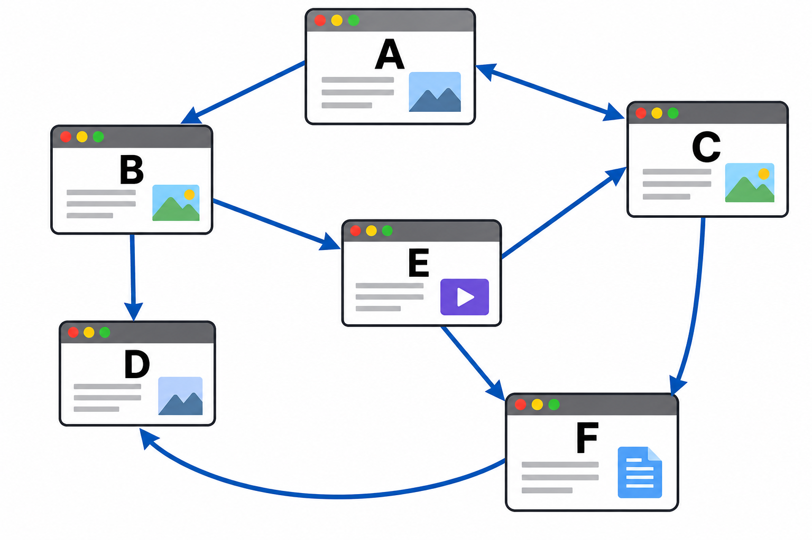
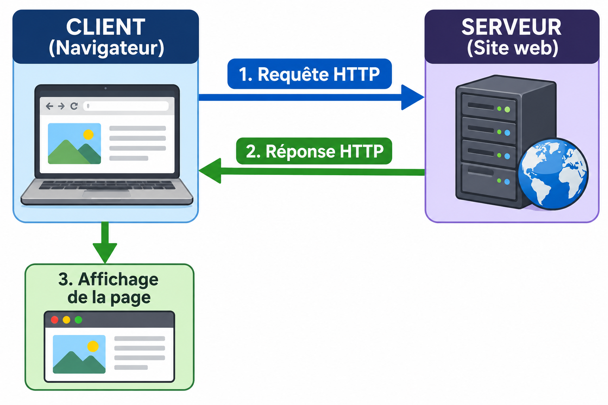

# Thème 2 : Web { #web }

{ width="350" }

<a id="haut"></a>


## Chapitre 1. À la découverte du Web { #decouverte-web }

!!! abstract "Objectif"

    Dans ce chapitre, nous allons découvrir le World Wide Web, son fonctionnement général et les principes qui permettent de consulter des pages web.

    Nous chercherons notamment à comprendre :

    - quelle est la différence entre Internet et le Web ;
    - comment est né le World Wide Web ;
    - comment les pages web sont reliées entre elles ;
    - quel est le rôle d'un navigateur et d'un serveur web ;
    - comment fonctionne le modèle client-serveur.

### Contexte 1 : Une toile d'informations

Nous avons étudié Internet, le fonctionnement des réseaux ainsi que les différents protocoles permettant aux machines de communiquer.

Mais qu'est-ce qui différencie Internet et le Web ? Comment pouvons-nous passer d'une page à une autre en quelques clics ? Et où sont réellement stockées les pages que nous consultons ?

!!! question "Exercice 1 : Site Internet ou site Web ?"

    1. **Rappeler ce qu'est Internet.**

    2. **Quelle est la différence entre Internet et le Web ?**

    3. **Qu'est-ce qu'une page web ? Quelle est la différence avec un site web ?**

    4. **Comment les différentes pages web sont-elles reliées entre elles ?**

    5. **Où sont stockés les documents que nous consultons sur le Web ?**

    6. **Quel logiciel permet de consulter les pages web ?**

### 1.1 La naissance du World Wide Web

Le **World Wide Web**, généralement appelé **Web**, a été proposé par le Britannique **Tim Berners-Lee** en 1989, au CERN (Organisation européenne pour la recherche nucléaire). Le scientifique belge **Robert Cailliau** a également contribué à son développement.

À l'origine, le projet avait pour objectif de faciliter le partage d'informations entre les chercheurs du CERN. Il s'agissait de créer un système permettant de consulter des documents et de passer facilement de l'un à l'autre.

Le premier site web a été mis en ligne en 1991. Il présentait le fonctionnement du projet World Wide Web.

Le Web s'est ensuite progressivement développé pour devenir un service incontournable d'Internet.

!!! note "À retenir"

    Le **World Wide Web (Web)** est un système permettant de consulter des ressources reliées entre elles par des **liens hypertextes**.

    Il a été proposé par **Tim Berners-Lee**, avec la contribution de **Robert Cailliau**, à la fin des années 1980, au CERN.

### 1.2 Internet et Web : quelle différence ?

Il ne faut pas confondre **Internet** et **Web**.

- **Internet** est un réseau informatique mondial permettant à des machines de communiquer entre elles.
- **Le Web** est un service qui utilise Internet pour permettre la consultation de pages et de ressources reliées par des liens hypertextes.

Le Web n'est donc qu'un des nombreux services accessibles grâce à Internet.

Par exemple, les courriels, les transferts de fichiers ou encore certains jeux en ligne utilisent Internet sans nécessairement utiliser le Web.

!!! note "À retenir"

    **Internet est l'infrastructure de communication**, tandis que **le Web est un service qui fonctionne grâce à cette infrastructure**.

### 1.3 Pages web et liens hypertextes

Une **page web** est un document consultable à l'aide d'un navigateur. Elle peut contenir différents éléments :

- du texte ;
- des images ;
- des vidéos ;
- des sons ;
- des liens vers d'autres ressources.

Un **lien hypertexte** est un élément cliquable permettant d'accéder à une autre page ou à une autre ressource.

Les liens hypertextes permettent ainsi de naviguer d'une page à une autre sans avoir à connaître directement l'adresse de chaque document.

L'ensemble des pages reliées par ces liens forme une immense toile d'informations : le Web.

!!! note "À retenir"

    Un **lien hypertexte** permet de passer d'une ressource à une autre.

    Les pages web sont ainsi reliées entre elles et forment une immense toile de documents.

!!! question "Exercice 2 : La toile du Web"

    On considère un ensemble de pages web représentées par des cercles. Les flèches représentent les liens hypertextes présents sur ces pages.

    { width="550" }

    1. **Que représentent les flèches entre les différentes pages ?**

    2. **Pourquoi certaines flèches ne sont-elles présentes que dans un seul sens ?**

    3. **Est-il possible d'aller de la page A à la page F ? Si oui, donner un chemin possible.**

    4. **Est-il nécessaire qu'une page possède un lien vers une autre pour que cette dernière puisse exister ? Justifier.**

    5. **Pourquoi utilise-t-on le terme de « toile » pour désigner le Web ?**

### 1.4 Navigateur et serveur Web

Pour consulter une page web, on utilise un logiciel appelé **navigateur web**.

Parmi les navigateurs les plus connus, on peut citer :

- Mozilla Firefox ;
- Google Chrome ;
- Microsoft Edge ;
- Safari.

Le navigateur permet de consulter les ressources présentes sur le Web. Pour cela, il communique avec des ordinateurs distants appelés **serveurs web**.

Un serveur web est un ordinateur qui héberge des ressources accessibles sur le Web : pages, images, vidéos, fichiers, etc.

Lorsqu'un utilisateur souhaite consulter une page web, son navigateur demande la ressource au serveur qui l'héberge. Le serveur lui transmet alors les données nécessaires à son affichage.

On retrouve ainsi deux acteurs :

- le **client**, qui effectue une demande. Ici, il s'agit du navigateur web ;
- le **serveur**, qui reçoit la demande et fournit les ressources demandées.

### 1.5 Le modèle client-serveur

Le fonctionnement du Web repose sur un modèle appelé **client-serveur**.

Le déroulement général d'un échange est le suivant :

1. L'utilisateur saisit une adresse ou clique sur un lien dans son navigateur.
2. Le navigateur (client) envoie une demande au serveur web.
3. Le serveur reçoit et traite cette demande.
4. Le serveur renvoie les ressources demandées au navigateur.
5. Le navigateur interprète les données reçues et affiche la page à l'écran.

Ce fonctionnement repose sur des échanges de données entre le client et le serveur.

Nous étudierons dans le chapitre suivant les protocoles utilisés pour réaliser ces échanges.

!!! note "À retenir"

    Le modèle **client-serveur** repose sur deux acteurs :

    - le **client**, qui formule une demande ;
    - le **serveur**, qui reçoit cette demande et fournit une réponse.

    Dans le cas du Web, le navigateur joue le rôle du client et le serveur web héberge les ressources demandées.


## Chapitre 2. Comment fonctionne le Web ? { #fonctionnement-web }

!!! abstract "Objectif"

    Dans ce chapitre, nous allons étudier les échanges qui permettent à un navigateur de consulter les ressources hébergées sur un serveur web.

    Nous chercherons notamment à comprendre :

    - comment est constituée une URL ;
    - comment le navigateur et le serveur communiquent grâce au protocole HTTP ;
    - quel est le rôle du protocole HTTPS ;
    - comment interpréter les principaux codes d'état HTTP ;
    - comment observer les échanges entre un navigateur et un serveur.


### Contexte 2 : Dans les coulisses du Web

Lorsque nous consultons un site web, tout semble simple : nous saisissons une adresse, appuyons sur Entrée et la page apparaît à l'écran.

Pourtant, plusieurs échanges ont lieu entre notre navigateur et le serveur qui héberge le site.

Comment le navigateur sait-il où trouver une page ? Comment formule-t-il sa demande ? Et comment le serveur lui indique-t-il si la ressource demandée existe ?

---

### 2.1 Les adresses des ressources : les URL

Chaque ressource accessible sur le Web possède une adresse permettant de la localiser. Cette adresse est appelée **URL** (*Uniform Resource Locator*).

Une URL peut désigner une page web, une image, une vidéo ou encore un fichier.

Prenons l'exemple de l'adresse suivante :

```text
https://fr.wikipedia.org/wiki/World_Wide_Web
```


Une URL peut être décomposée en plusieurs parties :

| Partie | Exemple | Rôle |
|---|---|---|
| Protocole | `https` | Indique le protocole utilisé pour communiquer |
| Nom de domaine | `fr.wikipedia.org` | Identifie le serveur à contacter |
| Chemin | `/wiki/World_Wide_Web` | Indique la ressource recherchée sur le serveur |

Une URL peut également contenir des informations supplémentaires :

```text
https://www.youtube.com/watch?v=MmQaLy38o
```

Dans cet exemple, la partie située après le `?` correspond à un **paramètre** de l'URL. Ici, `v` désigne l'identifiant de la vidéo demandée.

Enfin, le caractère `#` peut être utilisé pour désigner une partie précise d'une page, appelée **fragment** ou **ancre**.

!!! note "À retenir"

    Une **URL** est une adresse permettant de localiser une ressource sur le Web.

    Elle peut notamment contenir :

    - le protocole utilisé ;
    - le nom de domaine du serveur ;
    - le chemin de la ressource ;
    - des paramètres ou une ancre.

!!! question "Exercice 3 : Dissection d'une URL"

    Voici trois adresses :

    - `https://fr.wikipedia.org/wiki/World_Wide_Web`
    - `https://developer.mozilla.org/fr/docs/Web/HTML/Element/Form#Exemples`
    - `https://www.youtube.com/watch?v=MmQaLy38o`

    1. **Identifier le protocole utilisé dans chacune de ces adresses.**

    2. **Identifier le nom de domaine de chaque adresse.**

    3. **Repérer le chemin de la ressource dans chacune des URL.**

    4. **Dans les deux dernières adresses, identifier les éléments situés après `#` et `?`.**

    5. **Expliquer le rôle de ces différents éléments.**

---

### 2.2 Le protocole HTTP

Pour communiquer, le navigateur et le serveur doivent utiliser un langage commun et respecter des règles précises.

Sur le Web, ces règles sont définies par le protocole **HTTP** (*HyperText Transfer Protocol*).

HTTP permet au client et au serveur d'échanger des informations sous la forme de **requêtes** et de **réponses**.

Lorsqu'un utilisateur souhaite consulter une page web :

1. Le navigateur prépare une requête HTTP contenant notamment la ressource demandée.
2. Il transmet cette requête au serveur.
3. Le serveur analyse la demande et recherche la ressource.
4. Il renvoie une réponse HTTP au navigateur.
5. Le navigateur interprète les données reçues et affiche la page.

Voici une représentation simplifiée de cet échange :

{ width="550" }

Une page web peut nécessiter plusieurs échanges : le navigateur peut notamment devoir récupérer séparément les images, les feuilles de style ou les autres ressources utilisées par la page.

!!! note "À retenir"

    Le protocole **HTTP** définit les règles de communication entre un navigateur et un serveur web.

    Les échanges reposent sur deux éléments :

    - une **requête**, envoyée par le client ;
    - une **réponse**, renvoyée par le serveur.

### 2.3 HTTP ou HTTPS ?

Lorsque nous consultons un site web, nous pouvons observer que son adresse commence généralement par `http://` ou `https://`.

Le protocole **HTTPS** (*HyperText Transfer Protocol Secure*) est une version sécurisée de HTTP.

Il ajoute une couche de sécurité reposant sur le protocole **TLS** (*Transport Layer Security*), qui permet notamment :

- de chiffrer les données échangées entre le navigateur et le serveur ;
- de vérifier l'identité du serveur grâce à un certificat numérique ;
- de garantir que les données échangées n'ont pas été modifiées pendant leur transmission.

Ainsi, une personne qui intercepterait les échanges ne pourrait normalement pas lire directement les données chiffrées.

Dans un navigateur, la présence d'un cadenas à côté de l'adresse indique généralement que la connexion utilise HTTPS. Cependant, une connexion HTTPS ne garantit pas que le site lui-même est digne de confiance. Un site frauduleux peut également utiliser HTTPS.

!!! note "À retenir"

    **HTTPS est la version sécurisée de HTTP.**

    Il utilise TLS pour protéger les échanges entre le navigateur et le serveur, notamment grâce au chiffrement et à l'authentification du serveur.

!!! question "Exercice 4 : Sécurité des échanges"

    1. **Quelle est la différence entre HTTP et HTTPS ?**

    2. **Quel est le rôle du chiffrement dans les échanges entre un navigateur et un serveur ?**

    3. **Pourquoi est-il important de vérifier que l'on utilise HTTPS lorsqu'on saisit un mot de passe ou des informations bancaires ?**

    4. **Un site utilisant HTTPS est-il nécessairement un site fiable ? Justifier.**

---

### 2.4 Les réponses du serveur : les codes HTTP

Lorsqu'un serveur reçoit une requête HTTP, il renvoie une réponse accompagnée d'un **code d'état HTTP**.

Ce code permet au navigateur de connaître le résultat du traitement de la demande.

Voici quelques codes courants :

| Code | Signification | Explication |
|---|---|---|
| `200` | OK | La requête a été traitée avec succès. |
| `301` | Moved Permanently | La ressource a été déplacée définitivement. |
| `403` | Forbidden | L'accès à la ressource est interdit. |
| `404` | Not Found | La ressource demandée n'a pas été trouvée. |
| `500` | Internal Server Error | Le serveur a rencontré une erreur interne. |

Les codes HTTP sont regroupés en plusieurs catégories :

- `1xx` : informations ;
- `2xx` : succès ;
- `3xx` : redirections ;
- `4xx` : erreurs liées à la requête du client ;
- `5xx` : erreurs liées au serveur.

!!! note "À retenir"

    Un **code d'état HTTP** accompagne la réponse du serveur et indique le résultat de la requête.

    Les codes les plus courants commencent par :

    - `2` : la demande a été traitée avec succès ;
    - `3` : une redirection est nécessaire ;
    - `4` : la requête comporte un problème ou l'accès est refusé ;
    - `5` : le serveur a rencontré une erreur.

!!! question "Exercice 5 : Erreur 404 !"

    Pour chaque situation, associer le code HTTP correspondant parmi les suivants : `200`, `301`, `403`, `404` et `500`.

    1. **Un utilisateur consulte une page qui existe et à laquelle il a accès.**

    2. **Un utilisateur tente d'accéder à une page qui n'existe plus à l'adresse indiquée.**

    3. **Un utilisateur tente d'accéder à une page réservée aux administrateurs du site.**

    4. **Un site a changé définitivement l'adresse d'une de ses pages.**

    5. **Le serveur rencontre un problème technique qui l'empêche de répondre correctement.**


!!! activity "Activité — Dans les coulisses d'une page Web"

    **Objectif :** observer les échanges entre le navigateur et un serveur lors du chargement d'une page Web.

    **Outil :** les outils de développement du navigateur.

    1. Ouvrir le navigateur et se rendre sur le site [Wikipédia](https://fr.wikipedia.org/).
    2. Faire un clic droit sur la page, puis sélectionner « Inspecter ».
    3. Ouvrir l'onglet « Réseau » (ou « Network »).
    4. Actualiser la page pour observer les échanges.
    5. Cliquer sur quelques lignes de la liste pour consulter les informations des requêtes.

    **Questions**

    1. Combien de requêtes sont effectuées lors du chargement de la page ?
    2. Les requêtes concernent-elles toutes le même domaine ?
    3. Repérer les différents types de ressources téléchargées (document, image, script, feuille de style...).
    4. Repérer la colonne indiquant le code d'état HTTP. Que signifie le code `200` ?
    5. Pourquoi le navigateur doit-il effectuer plusieurs requêtes pour afficher une seule page Web ?

    **Bilan :** expliquer pourquoi l'affichage d'une page Web nécessite généralement plusieurs échanges entre le navigateur et différents serveurs.


---

### Bilan

Pour consulter une ressource sur le Web, le navigateur utilise son URL afin de contacter le serveur qui l'héberge.

La communication entre les deux machines repose sur le protocole HTTP ou sa version sécurisée HTTPS. Le serveur répond à chaque requête en transmettant les ressources demandées et un code d'état indiquant le résultat de la demande.


## Chapitre 3. Rechercher et s'informer sur le Web { #rechercher-web }


!!! abstract "Objectif"

    Dans ce chapitre, nous allons découvrir comment les moteurs de recherche permettent de retrouver des informations sur le Web et comment évaluer la fiabilité des contenus consultés.

    Nous chercherons notamment à comprendre :

    - comment fonctionne un moteur de recherche ;
    - comment les pages web sont explorées, indexées et classées ;
    - quels critères influencent le classement des résultats ;
    - comment évaluer la fiabilité d'une information ;
    - comment identifier et vérifier les fausses informations.

### Contexte 3 : Trouver une information dans une immense toile

Le Web contient des milliards de pages et de ressources. Pourtant, en quelques secondes, un moteur de recherche permet de trouver des informations sur presque n'importe quel sujet.

Mais comment un moteur de recherche parvient-il à retrouver les pages qui nous intéressent parmi toutes celles qui existent ? Et surtout, les premiers résultats proposés sont-ils nécessairement les plus fiables ?

---

### 3.1 Le fonctionnement d'un moteur de recherche

Un **moteur de recherche** est un service permettant de retrouver des ressources sur le Web à partir de mots-clés saisis par un utilisateur.

Pour proposer des résultats, un moteur de recherche réalise plusieurs opérations.

**1. L'exploration du Web**

Des programmes automatisés, appelés robots d'exploration (*crawlers*), parcourent régulièrement le Web.

Ils visitent des pages, récupèrent leur contenu et suivent les liens hypertextes présents sur ces pages afin d'en découvrir de nouvelles.

**2. L'indexation**

Les pages découvertes sont analysées afin d'en extraire des informations : mots présents dans le texte, titres, liens, images, etc.

Le moteur de recherche construit alors un **index**, c'est-à-dire une immense base de données qui associe des mots aux pages dans lesquelles ils apparaissent.

**3. Le classement des résultats**

Lorsqu'un utilisateur effectue une recherche, le moteur consulte son index pour identifier les pages correspondant aux mots-clés.

Il classe ensuite les résultats en fonction de nombreux critères : pertinence du contenu, popularité de la page, qualité des liens qui y renvoient, actualité de l'information, etc.

Les résultats sont alors présentés à l'utilisateur dans un ordre déterminé par l'algorithme du moteur de recherche.

Le classement peut également varier selon la langue, la localisation de l'utilisateur ou les éventuels paramètres de personnalisation du moteur de recherche.

!!! note "À retenir"

    Un moteur de recherche fonctionne principalement en trois étapes :

    - **Exploration** : les robots parcourent le Web pour découvrir les pages.
    - **Indexation** : le contenu des pages est analysé et enregistré dans un index.
    - **Classement** : les pages correspondant à la recherche sont ordonnées selon différents critères.

!!! question "Exercice 6 : Construire un index"

    On souhaite construire un petit moteur de recherche à partir de deux pages web.

    Voici le contenu de ces deux pages :

    **Page `Avocat.html`**

    ```text
    Titre : Avocat

    L'avocat est le fruit de l'avocatier, un arbre originaire du Mexique.
    ```

    **Page `Fruit.html`**

    ```text
    Titre : Fruit

    Un fruit est un aliment végétal, à la saveur sucrée,
    généralement consommé cru.
    ```

    Pour construire notre index, nous allons attribuer une importance différente aux mots selon leur emplacement :

    - un mot présent dans le titre vaut **5 points** ;
    - un mot présent dans le texte vaut **1 point par occurrence**.

    1. **Pour chaque page, relever les mots présents dans le titre et dans le texte.**

    2. **Construire un index associant chaque mot aux pages dans lesquelles il apparaît et à son score.**

    3. **Effectuer une recherche avec le mot-clé `avocat`. Quelle page obtient le meilleur score ?**

    4. **Effectuer une recherche avec le mot-clé `fruit`. Quelle page obtient le meilleur score ?**

    5. **Effectuer une recherche avec les mots-clés `avocat droit`. On suppose que le premier mot-clé compte double. Calculer le score de chaque page. Qu'observe-t-on ?**

    6. **Effectuer une recherche avec les mots-clés `un avocat fruit`. Comparer les résultats avec ceux de la question précédente.**

    7. **Pourquoi le classement des résultats peut-il varier selon les mots-clés utilisés ?**


!!! activity "Activité — Les moteurs de recherche donnent-ils tous les mêmes résultats ?"

    **Objectif :** comparer les résultats proposés par différents moteurs de recherche et réfléchir aux critères qui influencent leur classement.

    **Outils :** [Google](https://www.google.com/), [Bing](https://www.bing.com/) et [Qwant](https://www.qwant.com/).

    1. Effectuer la même recherche sur les trois moteurs : `réchauffement climatique`.
    2. Observer les cinq premiers résultats proposés par chaque moteur.
    3. Relever les titres des pages et les sites auxquels elles appartiennent.

    **Questions**

    1. Les trois moteurs proposent-ils exactement les mêmes résultats ?
    2. Les résultats apparaissent-ils dans le même ordre ?
    3. Quels types de sites sont mis en avant ?
    4. Pourquoi deux moteurs de recherche peuvent-ils proposer des classements différents pour une même recherche ?
    5. Peut-on considérer que le premier résultat est nécessairement le plus fiable ?

    **Bilan :** expliquer pourquoi il est important de comparer plusieurs sources et de ne pas se fier uniquement à la position d'un résultat.


### 3.2 La pertinence des résultats

Les moteurs de recherche utilisent des algorithmes pour déterminer l'ordre dans lequel les pages apparaissent.

Le classement ne dépend pas uniquement de la présence des mots recherchés. Plusieurs critères peuvent être pris en compte :

- la correspondance entre les mots-clés et le contenu de la page ;
- la présence des mots dans le titre ou les différentes parties du document ;
- la popularité de la page et les liens qui pointent vers elle ;
- la fraîcheur des informations ;
- la localisation ou les habitudes de recherche de l'utilisateur.

Les moteurs de recherche cherchent ainsi à proposer les résultats qui semblent les plus pertinents pour chaque utilisateur.

Cependant, **un résultat placé en première position n'est pas nécessairement le plus fiable**.

Certains sites cherchent à améliorer artificiellement leur classement en multipliant les mots-clés, en utilisant des titres accrocheurs ou en produisant des contenus destinés à attirer les clics.

Les algorithmes peuvent également favoriser des contenus qui suscitent beaucoup de réactions, sans que leur véracité soit garantie.

!!! note "À retenir"

    Le classement des résultats d'un moteur de recherche repose sur différents critères.

    La position d'une page dans les résultats ne garantit pas la fiabilité des informations qu'elle contient.

---

### 3.3 Évaluer la fiabilité d'une information

Le Web permet d'accéder à une quantité considérable d'informations, mais toutes ne sont pas nécessairement exactes ou vérifiées.

Il est donc important de développer un regard critique sur les contenus consultés.

Pour évaluer la fiabilité d'une information, plusieurs réflexes sont utiles :

1. **Identifier la source** : qui est à l'origine de l'information ? S'agit-il d'un média reconnu, d'un organisme officiel, d'un spécialiste ou d'un auteur inconnu ?

2. **Vérifier la date** : l'information est-elle récente ? Est-elle toujours d'actualité ?

3. **Examiner les preuves** : l'auteur cite-t-il des sources, des études ou des documents permettant de vérifier ses affirmations ?

4. **Recouper les informations** : d'autres sources fiables confirment-elles cette information ?

5. **Distinguer les faits des opinions** : l'auteur présente-t-il des faits vérifiables ou exprime-t-il simplement un point de vue ?

Il faut également se méfier des titres sensationnalistes, des images sorties de leur contexte et des contenus qui cherchent avant tout à provoquer une réaction.

!!! note "À retenir"

    Pour évaluer une information, il faut notamment :

    - identifier son auteur et sa source ;
    - vérifier sa date de publication ;
    - rechercher les éléments qui permettent de la justifier ;
    - comparer avec d'autres sources fiables ;
    - distinguer les faits des opinions.

### 3.4 Les fausses informations

Une **fausse information** est une information inexacte ou trompeuse diffusée auprès du public.

On distingue notamment deux situations :

- La **mésinformation** correspond à la diffusion d'une information fausse sans intention délibérée de tromper.
- La **désinformation** correspond à la diffusion volontaire d'une information fausse dans le but de tromper ou d'influencer.

Les fausses informations peuvent se propager rapidement sur les réseaux sociaux et les plateformes de partage.

Elles peuvent notamment être utilisées pour manipuler l'opinion, nuire à une personne ou une organisation, ou encore provoquer des réactions.

Le terme **fake news** est souvent employé pour désigner ce type de contenu, même s'il peut recouvrir des situations différentes.

### 3.5 Le fact-checking

Le **fact-checking**, ou vérification des faits, consiste à vérifier la véracité d'une information en s'appuyant sur des sources et des éléments vérifiables.

Cette démarche peut notamment consister à :

- retrouver l'origine d'une information ;
- vérifier une citation ou une déclaration ;
- rechercher la source d'une image ;
- comparer plusieurs articles ;
- consulter des organismes ou des spécialistes compétents.

Des médias et des organismes proposent des rubriques ou des outils dédiés à la vérification des informations.

Il est également possible d'utiliser la recherche d'image inversée pour retrouver les premières publications d'une photographie ou vérifier si elle a été utilisée dans un autre contexte.

!!! question "Exercice 7 : Peut-on faire confiance à cette information ?"

    On étudie plusieurs situations rencontrées sur le Web.

    **Document A : Un classement dans un moteur de recherche**

    Un site apparaît en première position dans les résultats d'une recherche. Son titre est particulièrement accrocheur et invite l'utilisateur à cliquer rapidement. Cependant, l'article ne cite aucune source et ne précise pas l'origine des informations présentées.

    **Document B : Un article de Wikipédia**

    Wikipédia est une encyclopédie collaborative alimentée par des contributeurs bénévoles. Les articles peuvent être modifiés par les utilisateurs et leur historique permet de retrouver les différentes versions d'un texte.

    **Document C : Une photographie partagée sur un réseau social**

    Une photographie est publiée avec la légende suivante : « Cette image montre un événement qui vient de se produire en France ». Aucune date ni source n'est indiquée. Une recherche d'image inversée permet de découvrir que la photographie a en réalité été publiée plusieurs années auparavant dans un autre pays.

    1. **Document A : Pourquoi la première position dans un moteur de recherche ne garantit-elle pas la fiabilité d'un site ?**

    2. **Document B : Quels sont les avantages et les limites du fonctionnement collaboratif de Wikipédia ?**

    3. **Document C : Pourquoi est-il important de vérifier l'origine et la date d'une photographie ?**

    4. **Quelle démarche pourriez-vous suivre avant de partager une information trouvée sur un réseau social ?**

    5. **Expliquer ce que signifie le terme fact-checking.**

---

### Bilan

Les moteurs de recherche permettent de retrouver rapidement des informations grâce à l'exploration et à l'indexation des pages web, puis à leur classement selon différents critères.

Cependant, les résultats proposés ne sont pas nécessairement fiables. Il est donc essentiel de vérifier les sources, de recouper les informations et de conserver un regard critique sur les contenus consultés.


## Chapitre 4. Identité numérique, traces et droits sur le Web { #traces-droits-web }


!!! abstract "Objectif"

    Dans ce chapitre, nous allons étudier les traces laissées lors de la navigation sur le Web, les moyens de protéger notre vie privée et les règles qui encadrent la réutilisation des ressources numériques.

    Nous chercherons notamment à comprendre :

    - quelles informations peuvent être conservées lors de la navigation ;
    - quel est le rôle des cookies ;
    - comment limiter la collecte de données personnelles ;
    - ce que protège le droit d'auteur ;
    - comment fonctionnent les licences Creative Commons.

### Contexte 4 : Que sait le Web sur nous ?

Lorsque nous naviguons sur le Web, nous consultons des pages, effectuons des recherches, regardons des vidéos ou encore achetons des produits.

Ces actions peuvent laisser des traces numériques. Certaines permettent aux sites de fonctionner correctement, tandis que d'autres servent à analyser nos habitudes ou à personnaliser les publicités.

Mais quelles informations laissons-nous réellement derrière nous ? Comment les sites peuvent-ils les récupérer ? Et comment protéger notre vie privée ?

---

### 4.1 Les traces numériques

Lorsque nous utilisons un navigateur, différentes informations peuvent être enregistrées :

- les pages consultées ;
- les recherches effectuées ;
- les fichiers téléchargés ;
- les préférences de navigation ;
- les interactions avec les sites ;
- certaines informations techniques sur notre appareil.

Ces informations constituent des **traces numériques**.

Elles peuvent être conservées directement sur notre appareil, par exemple dans l'historique du navigateur, ou enregistrées sur les serveurs des sites que nous consultons.

Les sites et les services en ligne peuvent utiliser ces informations pour mémoriser nos préférences, améliorer leurs services ou analyser notre comportement.

Certaines données peuvent également être utilisées à des fins publicitaires.

### 4.2 Les cookies

Un **cookie** est une donnée qu'un site web peut enregistrer dans le navigateur de l'utilisateur. Elle permet notamment de mémoriser certaines informations lors de la navigation.

Lorsqu'un utilisateur revient sur un site, le navigateur peut renvoyer les informations contenues dans les cookies afin que le site puisse reconnaître certaines informations précédemment enregistrées.

Les cookies peuvent avoir plusieurs fonctions :

- mémoriser la langue choisie sur un site ;
- conserver le contenu d'un panier d'achat ;
- maintenir une session ouverte après une connexion ;
- mémoriser certaines préférences ;
- suivre la navigation d'un utilisateur à des fins statistiques ou publicitaires.

Il existe notamment des cookies déposés directement par le site consulté et des cookies provenant de services tiers intégrés à ce site.

Ces derniers peuvent notamment être utilisés pour suivre la navigation d'un utilisateur sur plusieurs sites. Toutefois, cette possibilité dépend des paramètres du navigateur et des restrictions appliquées aux cookies tiers.

!!! note "À retenir"

    Un **cookie** est une donnée enregistrée par un site web dans le navigateur d'un utilisateur.

    Il peut servir à mémoriser des préférences, faciliter la navigation ou suivre certaines activités à des fins statistiques et publicitaires.

### 4.3 Protéger sa vie privée

Il est possible de limiter les informations collectées pendant la navigation en configurant correctement son navigateur.

Quelques précautions permettent de mieux protéger sa vie privée :

- limiter ou bloquer certains cookies, notamment ceux provenant de services tiers ;
- supprimer régulièrement l'historique de navigation et les cookies ;
- contrôler les autorisations accordées aux sites (microphone, caméra, localisation, notifications...) ;
- utiliser des moteurs de recherche qui limitent la collecte de données personnelles ;
- éviter de communiquer des informations personnelles lorsque cela n'est pas nécessaire.

Il faut également rester attentif aux autorisations demandées par les sites et aux informations que l'on publie volontairement sur le Web.

!!! note "À retenir"

    Pour protéger sa vie privée sur le Web, il est important de :

    - contrôler les cookies et les traceurs ;
    - gérer les autorisations accordées aux sites ;
    - limiter les informations personnelles communiquées ;
    - paramétrer régulièrement son navigateur.

!!! activity "Activité — Big Brother"

    **Partie A : Observer les traces laissées par la navigation**

    1. Ouvrir les paramètres de confidentialité de votre navigateur.

    2. Consulter l'historique de navigation et observer les informations enregistrées.

    3. Consulter les cookies et les données enregistrées par les sites.

    4. Choisir un site que vous avez déjà consulté et observer les informations conservées.

    **Partie B : Comprendre la publicité personnalisée**

    5. Si vous disposez d'un compte Google, consulter le centre de gestion des annonces : https://myadcenter.google.com/

    6. Quelles catégories d'informations peuvent être utilisées pour personnaliser les publicités ?

    7. Pourquoi les entreprises peuvent-elles être intéressées par la collecte de ces informations ?

    8. Citer trois paramètres du navigateur permettant de mieux protéger sa vie privée.

---

### 4.4 Le droit d'auteur sur le Web

Le Web donne accès à une grande quantité de ressources numériques : images, textes, vidéos, musiques, logiciels, etc.

Cependant, le fait qu'une ressource soit accessible librement sur Internet ne signifie pas qu'elle peut être utilisée ou diffusée librement.

Une œuvre originale est protégée par le **droit d'auteur**. Celui-ci reconnaît à son créateur des droits sur son œuvre et définit les conditions dans lesquelles elle peut être utilisée, reproduite ou diffusée.

Par exemple, télécharger une photographie trouvée sur Internet ne donne pas automatiquement le droit de la publier sur son propre site.

Il est donc nécessaire de vérifier les conditions d'utilisation d'une ressource avant de la réutiliser.

### 4.5 Les licences Creative Commons

Certaines licences permettent aux auteurs d'autoriser à l'avance certaines utilisations de leurs œuvres.

C'est notamment le cas des licences **Creative Commons (CC)**.

Elles permettent aux créateurs de préciser les conditions dans lesquelles leurs œuvres peuvent être utilisées et diffusées.

Voici les principaux symboles utilisés par ces licences :

| Symbole | Signification |
|---|---|
| BY | Attribution : citer le nom de l'auteur |
| NC | Pas d'utilisation commerciale |
| ND | Pas de modification de l'œuvre |
| SA | Partage dans les mêmes conditions |

Par exemple, une licence **CC BY** autorise la réutilisation et la modification d'une œuvre, y compris à des fins commerciales, à condition de citer son auteur.

Une licence **CC BY-NC-ND** autorise le partage de l'œuvre à condition de citer son auteur, sans utilisation commerciale et sans modification.

!!! note "À retenir"

    Le **droit d'auteur** protège les œuvres originales et définit les conditions de leur utilisation.

    Les licences **Creative Commons** permettent aux auteurs d'autoriser certaines utilisations de leurs œuvres selon des conditions précises.

    Il faut toujours vérifier la licence d'une ressource avant de la réutiliser ou de la diffuser.

!!! question "Exercice 8 : Objection !"

    1. **Peut-on librement réutiliser une image trouvée sur Internet ? Justifier.**

    2. **Qu'est-ce que le droit d'auteur ?**

    3. **À quoi servent les licences Creative Commons ?**

    4. **Que signifie la licence CC BY ?**

    5. **Peut-on modifier et utiliser commercialement une œuvre sous licence CC BY-NC-ND ? Justifier.**

    6. **Vous souhaitez utiliser une photographie sous licence CC BY dans un site web scolaire. Quelles informations devez-vous indiquer ?**

---

### Bilan

La navigation sur le Web laisse des traces numériques qui peuvent être enregistrées par les navigateurs et les sites consultés. Les cookies permettent notamment de mémoriser des informations et peuvent être utilisés à des fins publicitaires.

Il est donc important de contrôler les données communiquées et de paramétrer son navigateur afin de protéger sa vie privée.

Par ailleurs, les ressources disponibles sur le Web restent soumises au droit d'auteur. Leur réutilisation doit respecter les conditions définies par leur auteur ou leur licence.


## Chapitre 5. Construire un site Web { #construire-site-web }

!!! abstract "Objectif"

    Dans ce chapitre, nous allons découvrir les langages et les mécanismes utilisés pour construire et faire fonctionner des pages web.

    Nous chercherons notamment à comprendre :

    - comment structurer une page avec le langage HTML ;
    - comment modifier l'apparence d'une page avec le langage CSS ;
    - quelle est la différence entre un site statique et un site dynamique ;
    - comment le navigateur transmet des données au serveur ;
    - quelle est la différence entre les méthodes HTTP GET et POST.

### Contexte 5 : Dans les coulisses d'un site Web

Nous avons appris à consulter des pages web, à comprendre comment elles sont transmises par les serveurs et à rechercher des informations.

Mais comment ces pages sont-elles réellement fabriquées ? Comment peut-on ajouter du texte, des images, des liens ou encore modifier leur apparence ?

Pour comprendre cela, nous allons découvrir les langages utilisés pour construire les pages web.

---

### 5.1 Le langage HTML : structurer une page

Le langage **HTML** (*HyperText Markup Language*) est un langage de balisage permettant de décrire le contenu et la structure d'une page web.

Il permet notamment d'organiser les éléments d'une page :

- les titres ;
- les paragraphes ;
- les images ;
- les liens hypertextes ;
- les listes ;
- les tableaux.

Le HTML utilise des **balises** pour identifier les différents éléments d'une page.

Une balise est généralement constituée d'une balise ouvrante et d'une balise fermante :

```html
<p>Voici un paragraphe.</p>
```

Dans cet exemple :

- `<p>` est la balise ouvrante ;
- `</p>` est la balise fermante ;
- `Voici un paragraphe.` est le contenu de l'élément.

Une page HTML possède une structure générale :

```html
<!DOCTYPE html>
<html>
    <head>
        <title>Ma première page</title>
    </head>
    <body>
        <h1>Bienvenue sur mon site</h1>
        <p>Voici ma première page web.</p>
    </body>
</html>
```

Les principales balises de cette structure sont :

| Balise | Rôle |
|---|---|
| `<html>` | Contient l'ensemble du document HTML |
| `<head>` | Contient les informations sur le document |
| `<title>` | Définit le titre affiché dans l'onglet du navigateur |
| `<body>` | Contient le contenu visible de la page |
| `<h1>` | Définit un titre de niveau 1 |
| `<p>` | Définit un paragraphe |

Il existe de nombreuses autres balises permettant d'enrichir une page.

Par exemple :

| Balise | Rôle |
|---|---|
| `<h2>` | Définit un titre de niveau 2 |
| `<a>` | Crée un lien hypertexte |
| `` | Insère une image |
| `<ul>` | Crée une liste à puces |
| `<li>` | Définit un élément de liste |

Pour créer un lien hypertexte, on utilise notamment l'attribut `href` :

```html
<a href="https://www.wikipedia.org">Consulter Wikipédia</a>
```

Pour insérer une image, on utilise la balise `` et son attribut `src` :

```html

```

L'attribut `alt` permet de fournir une description textuelle de l'image, notamment utile pour l'accessibilité.

!!! note "À retenir"

    Le **HTML** est un langage de balisage qui permet de structurer le contenu d'une page web.

    Il utilise des balises pour organiser les différents éléments : titres, paragraphes, images, liens, listes, etc.

### 5.2 Le langage CSS : mettre en forme une page

Le langage **CSS** (*Cascading Style Sheets*) permet de définir la présentation des pages HTML.

Il permet notamment de modifier :

- les couleurs ;
- les polices d'écriture ;
- les tailles des textes ;
- les marges et les espacements ;
- la disposition des éléments ;
- les bordures et les arrière-plans.

Par exemple, le code CSS suivant permet de modifier l'apparence des titres et des paragraphes :

```css
h1 {
    color: blue;
    text-align: center;
}

p {
    font-size: 18px;
    color: gray;
}
```

Dans cet exemple, les titres de niveau 1 seront affichés en bleu et centrés. Les paragraphes seront affichés en gris avec une taille de texte de 18 pixels.

Le CSS est généralement placé dans un fichier séparé, portant l'extension `.css`.

Pour associer une feuille de style à une page HTML, on utilise la balise `<link>` dans la partie `<head>` du document :

```html
<head>
    <title>Ma première page</title>
    <link rel="stylesheet" href="style.css">
</head>
```

On distingue donc deux rôles complémentaires :

- le HTML définit le contenu et la structure de la page ;
- le CSS définit sa présentation.


!!! activity "Activité — Dans la peau d'un développeur Web"

    **Objectif :** comprendre le rôle du HTML et du CSS en observant et en modifiant une page Web.

    **Outil :** les outils de développement du navigateur.

    1. Ouvrir le site [Wikipédia](https://fr.wikipedia.org/).
    2. Faire un clic droit sur un titre de la page, puis sélectionner « Inspecter ».
    3. Observer le code HTML correspondant à cet élément.
    4. Modifier directement le texte du titre dans l'inspecteur.
    5. Sélectionner ensuite un élément de la page et modifier une de ses propriétés CSS, par exemple sa couleur ou sa taille.

    **Questions**

    1. Quel langage permet de décrire le contenu et la structure de la page ?
    2. Quel langage permet de modifier son apparence ?
    3. Que constate-t-on lorsque l'on modifie le texte dans le code HTML ?
    4. Que constate-t-on lorsque l'on modifie une propriété CSS ?
    5. Les modifications réalisées sont-elles conservées lorsque l'on actualise la page ? Pourquoi ?

    **Bilan :** expliquer la différence entre le rôle du HTML et celui du CSS.


!!! note "À retenir"

    Le **HTML** définit le contenu et la structure d'une page web.

    Le **CSS** permet de personnaliser son apparence.

    Ces deux langages sont complémentaires et sont généralement utilisés ensemble.

!!! activity "Activité — Prends tes balises, on s'en va !"

    Télécharger l'archive `site_web` et en extraire le contenu. Ouvrir ensuite le fichier `index.html` dans un navigateur.

    **Partie A : Observer une page web**

    1. **Retrouver les informations suivantes dans les différentes pages du site :**

        - date de la naissance de l'hypertexte ;
        - nom de l'inventeur du World Wide Web ;
        - objectif du Web à sa création ;
        - noms des langages utilisés pour créer des pages web.

    **Partie B : Comprendre le HTML**

    2. Ouvrir la page dans le navigateur, effectuer un clic droit puis sélectionner « Inspecter ».

    3. En utilisant l'inspecteur, modifier certains éléments de la page. Observer les changements.

    4. Identifier le rôle des balises suivantes :

        - `title` ;
        - `h1` ;
        - `p` ;
        - `img` ;
        - `head` ;
        - `body`.

    5. **À quoi servent les attributs `src`, `alt` et `href` ?**

    **Partie C : Comprendre le CSS**

    6. Ouvrir le fichier `style.css` et modifier quelques propriétés.

    7. Observer les changements dans la page web.

    8. **Expliquer la différence entre le rôle d'un fichier HTML et celui d'un fichier CSS.**

---

### 5.3 Les sites statiques et dynamiques

Tous les sites web ne fonctionnent pas de la même manière.

On distingue notamment les **sites statiques** et les **sites dynamiques**.

Un **site statique** est constitué de pages dont le contenu est préparé à l'avance. Le serveur transmet les fichiers demandés au navigateur sans générer leur contenu à chaque requête.

Un **site dynamique** peut produire ou adapter son contenu à la demande, notamment en fonction des actions de l'utilisateur ou des données disponibles. Cette adaptation peut être réalisée côté serveur ou côté navigateur.

Par exemple :

- un site présentant les horaires d'une association peut être statique ;
- un réseau social affichant un fil d'actualité personnalisé est dynamique ;
- un site marchand affichant le contenu d'un panier est dynamique.

!!! note "À retenir"

    Un **site statique** transmet des pages dont le contenu est préparé à l'avance.

    Un **site dynamique** peut adapter le contenu affiché en fonction des demandes de l'utilisateur ou des données disponibles.

    Un même site web peut combiner des pages statiques et des fonctionnalités dynamiques. La distinction concerne donc le fonctionnement des pages ou des fonctionnalités, et pas nécessairement le site dans son ensemble.

!!! question "Exercice 9 : Deux types de sites"

    1. Consulter les deux sites suivants :

        - https://press.stripe.com/boom
        - https://www.service-public.fr/

    2. **Observer les différences entre les deux sites. Quels éléments semblent être statiques ou dynamiques ?**

    3. **Proposer une définition des termes « statique » et « dynamique ».**

    4. **Classer les situations suivantes selon le type de site qui semble le plus adapté :**

        - un site présentant les horaires d'ouverture d'une bibliothèque ;
        - un site permettant de consulter son compte bancaire ;
        - un site présentant les photographies d'une association ;
        - un site permettant de réserver une place de cinéma.

    5. **Pourquoi un site dynamique peut-il être nécessaire lorsque les informations affichées dépendent de l'utilisateur ?**

### 5.4 Les méthodes GET et POST

Nous avons vu que le navigateur communique avec un serveur web en lui envoyant des requêtes HTTP.

Ces requêtes peuvent utiliser différentes méthodes. Deux méthodes importantes sont **GET** et **POST**.


!!! activity "Activité — GET ou POST ?"

    **Objectif :** observer comment les données sont transmises entre un navigateur et un serveur.

    **Outil :** les outils de développement du navigateur.

    1. Ouvrir un moteur de recherche, par exemple [Google](https://www.google.com/).
    2. Ouvrir les outils de développement avec un clic droit, puis « Inspecter ».
    3. Sélectionner l'onglet « Réseau » (ou « Network »).
    4. Effectuer une recherche simple, par exemple `histoire du Web`.
    5. Repérer la requête correspondant à la recherche et observer sa méthode ainsi que son URL.
    6. Consulter les paramètres de la requête, si ceux-ci sont accessibles.

    **Questions**

    1. Quelle méthode HTTP est utilisée pour effectuer la recherche ?
    2. Peut-on retrouver les mots recherchés dans l'URL ?
    3. Pourquoi cette méthode est-elle adaptée à une recherche sur un moteur de recherche ?
    4. Quelle différence observe-t-on entre les données transmises avec une requête GET et celles transmises avec une requête POST ?
    5. Est-ce que l'utilisation de POST suffit à protéger les données transmises ? Justifier.

    **Bilan :** expliquer la différence entre les méthodes GET et POST. Préciser le rôle du protocole HTTPS dans la protection des échanges.

**La méthode GET**

La méthode GET permet de demander une ressource au serveur.

Elle peut également transmettre des paramètres directement dans l'URL.

Par exemple :

```text
https://www.google.com/search?q=normandie
```

Dans cette adresse, le paramètre `q` contient les mots recherchés : `normandie`.

Les paramètres transmis avec GET sont visibles dans l'adresse du navigateur. Ils peuvent donc être conservés dans l'historique ou partagés avec d'autres personnes.

**La méthode POST**

La méthode POST permet notamment d'envoyer des données au serveur dans le corps de la requête HTTP.

Elle est par exemple utilisée lorsqu'un utilisateur :

- remplit un formulaire ;
- crée un compte ;
- envoie un message ;
- transmet des informations à un site.

Contrairement à GET, les données transmises avec POST ne figurent pas directement dans l'URL.

Cependant, cela ne signifie pas qu'elles sont automatiquement protégées : le chiffrement des échanges repose notamment sur l'utilisation de HTTPS.

| Méthode | Utilisation principale | Transmission des paramètres |
|---|---|---|
| GET | Demander une ressource | Généralement dans l'URL |
| POST | Envoyer des données au serveur | Dans le corps de la requête |

!!! note "À retenir"

    Les méthodes **GET** et **POST** permettent d'effectuer différents types de requêtes HTTP.

    - **GET** permet principalement de demander une ressource. Les paramètres peuvent être visibles dans l'URL.
    - **POST** permet notamment d'envoyer des données au serveur dans le corps de la requête.

    POST ne chiffre pas les données : pour sécuriser leur transmission, il faut notamment utiliser HTTPS.

!!! question "Exercice 10 : GET-apens et POST-scriptum"

    1. **Quelle méthode HTTP permet de demander une ressource à un serveur ?**

    2. **Quelle méthode permet notamment d'envoyer les informations d'un formulaire ?**

    3. **Dans quelle partie de la requête sont transmises les données avec GET ? Et avec POST ?**

    4. **Pourquoi les paramètres transmis avec GET peuvent-ils poser un problème lorsqu'ils contiennent des informations personnelles ?**

    5. **POST permet-il à lui seul de protéger les informations envoyées au serveur ? Justifier.**

    6. **Pour chacune des situations suivantes, proposer la méthode la plus adaptée :**

        - effectuer une recherche sur un moteur de recherche ;
        - envoyer un formulaire d'inscription ;
        - consulter une page d'information ;
        - transmettre un message depuis un formulaire de contact.

---

### Bilan

La création d'un site web repose notamment sur deux langages complémentaires :

- le **HTML**, qui définit la structure et le contenu des pages ;
- le **CSS**, qui définit leur présentation.

Les sites peuvent être statiques ou dynamiques selon la manière dont leur contenu est produit.

Enfin, les échanges entre le navigateur et le serveur peuvent utiliser différentes méthodes HTTP, notamment GET et POST, selon la nature de la demande.

---

## Chapitre 6. Projet : Construire un site Web { #projet-site-web }

!!! abstract "Objectif"

    Dans ce projet, nous allons mobiliser les connaissances acquises au cours des chapitres précédents pour concevoir et réaliser un site web.

    Nous chercherons notamment à :

    - concevoir l'organisation et la navigation d'un site web ;
    - créer plusieurs pages en utilisant le langage HTML ;
    - personnaliser leur apparence avec une feuille de style CSS ;
    - intégrer des images et des liens hypertextes ;
    - respecter les règles relatives au droit d'auteur ;
    - tester et vérifier le bon fonctionnement du site.


### Objectif du projet

Le but de ce projet est de réaliser un site web sur un sujet de votre choix : sport, musique, cinéma, lecture, association, voyage, jeu vidéo, etc.

Le projet sera réalisé seul ou en groupe de deux élèves.

Le site devra être composé d'au moins **trois pages HTML** et d'au moins **une feuille de style CSS**.

Chaque élève devra participer à la réalisation du site et créer au moins une page.

### 6.1 Consignes

Votre site devra contenir :

- au moins trois pages HTML ;
- des titres et des paragraphes ;
- des images ;
- des liens hypertextes permettant de naviguer entre les pages ;
- une feuille de style CSS personnalisant l'apparence du site.

Le contenu devra être organisé et présenter un véritable intérêt pour les visiteurs.

Les ressources utilisées (images, textes, etc.) devront respecter le droit d'auteur et les conditions de leurs licences.

### 6.2 Les étapes du projet

Votre projet devra suivre les étapes suivantes :

1. **Choisir un sujet** et constituer éventuellement un binôme.

2. **Réaliser une maquette** sur papier en indiquant les différentes zones de chaque page : titres, textes, images, liens, menus, etc.

3. **Préparer le contenu** : rédiger les textes et sélectionner les images qui seront utilisées.

4. **Créer les pages HTML** en respectant la structure définie dans la maquette.

5. **Créer une feuille de style CSS** afin de personnaliser l'apparence du site.

6. **Tester le site** dans un navigateur et vérifier que les liens et les différentes pages fonctionnent correctement.

### 6.3 Organisation des fichiers

Pour commencer, créer un dossier portant le nom de votre projet.

L'organisation pourra ressembler à ceci :

```text
mon_site/
│
├── index.html
├── page2.html
├── page3.html
├── style.css
│
└── images/
    ├── image1.jpg
    ├── image2.png
    └── image3.jpg
```

Le fichier `index.html` correspond à la page d'accueil du site.

Les autres fichiers HTML correspondent aux différentes pages.

Le fichier `style.css` contient les règles de mise en forme utilisées par les pages.

Le dossier `images` contient les images utilisées dans le site.

### 6.4 Critères d'évaluation

Le projet sera évalué à partir des critères suivants :

| Critère | Éléments évalués |
|---|---|
| Respect des consignes | Nombre de pages, présence des éléments demandés |
| HTML | Structure et utilisation correcte des balises |
| CSS | Personnalisation de plusieurs éléments différents |
| Navigation | Présence de liens fonctionnels entre les pages |
| Contenu | Qualité et organisation des informations |
| Design | Lisibilité, cohérence et originalité de la présentation |
| Travail réalisé | Participation de chaque membre du groupe |

### 6.5 Quelques ressources utiles

Voici quelques ressources pour vous aider dans la réalisation de votre site :

- [W3Schools - HTML](https://www.w3schools.com/html/) : cours et exemples sur le langage HTML.
- [W3Schools - CSS](https://www.w3schools.com/css/) : cours et exemples sur le langage CSS.
- [MDN Web Docs](https://developer.mozilla.org/fr/docs/Web) : documentation sur les technologies du Web.
- [Validateur HTML du W3C](https://validator.w3.org/) : permet de vérifier la validité du code HTML.

!!! question "Projet : À vous de jouer !"

    Vous disposez de plusieurs séances pour concevoir et réaliser votre site web.

    À la fin du projet, vous devrez remettre l'ensemble du dossier contenant les fichiers HTML, CSS et les images utilisées.

    Le site devra pouvoir être ouvert localement dans un navigateur et permettre de naviguer entre ses différentes pages.